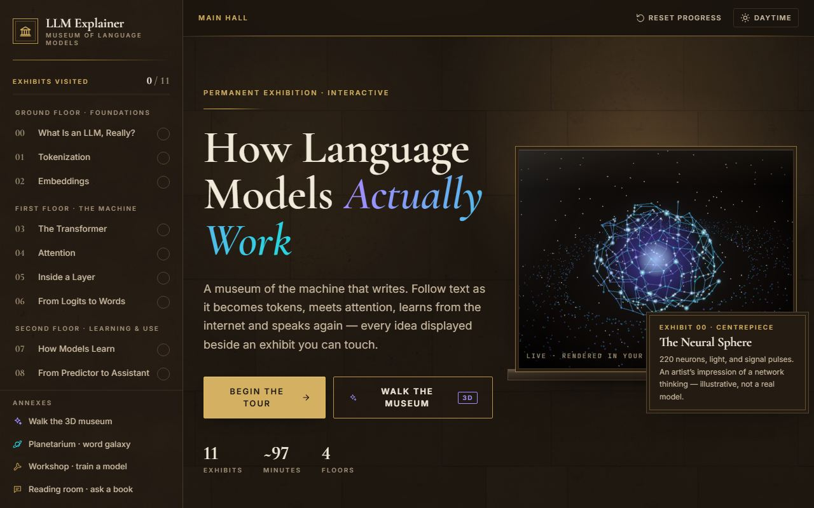
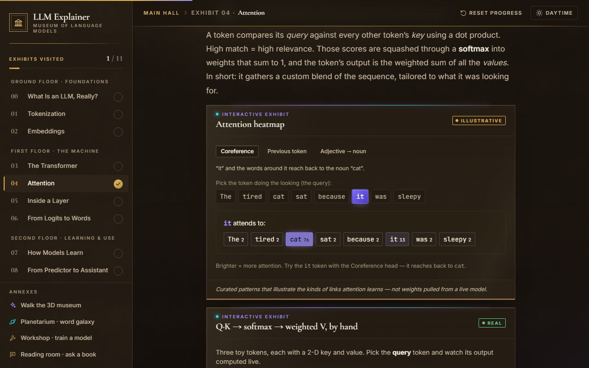
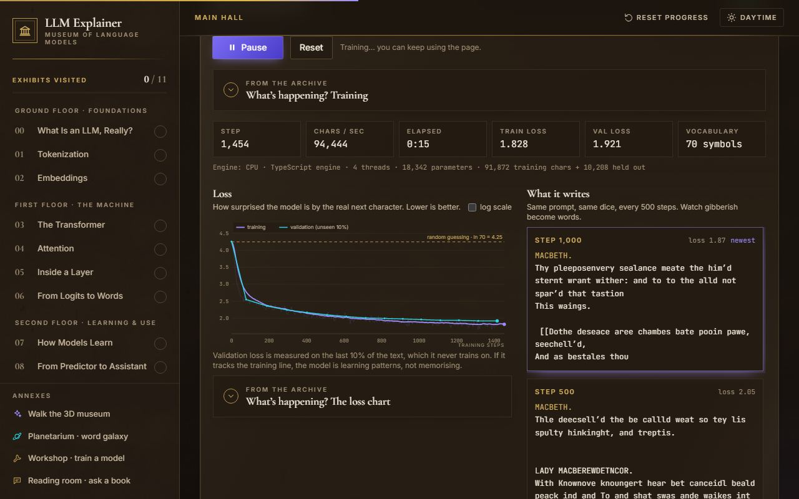
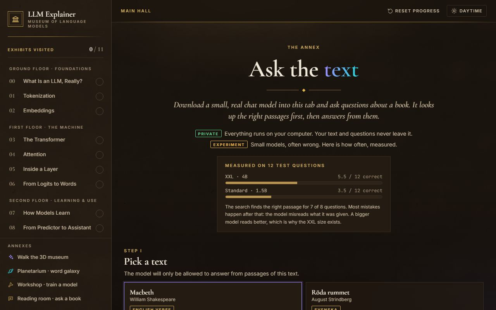
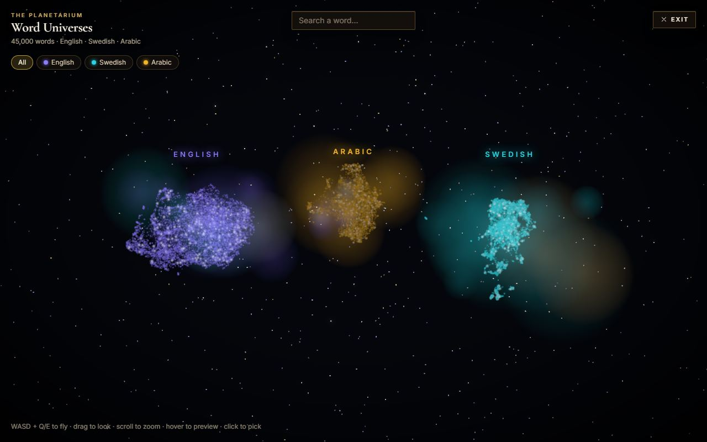

# LLM Explainer: how language models actually work

[](https://github.com/elias-b33/LLM-Explained/actions/workflows/ci.yml)

**Live: <https://llm-explainer-alpha.vercel.app>**

An interactive "museum" that explains large language models from tokens to chat assistants, and then lets you
**train a real GPT in your browser tab** and **ask questions about a book with a real LLM running on your own GPU**.
Nothing runs on a server: it is a static site, and every model, from the 18k-parameter toy to the 4B-parameter chat
model, runs client-side.



## Feature tour

| | |
|---|---|
| **11 illustrated chapters** (`/module/:slug`): tokenization (real `o200k_base` BPE), embeddings, attention, layers, sampling, pretraining, post-training, inference. Each idea has a small interactive exhibit next to it, labelled *real* (computed live) or *illustrative* (curated). |  |
| **The Workshop** (`/workshop`): train a character- or byte-level GPT on Macbeth, Strindberg or your own text and watch the loss fall and the samples turn from noise into words. Six sizes from 18k to 25.6M parameters, a CPU engine (TypeScript, multi-threaded) and a WebGPU engine, plus pretrained Large / Huge / XL checkpoints to fine-tune. |  |
| **Ask the text** (`/ask`): retrieval-augmented question answering over a whole book, in the tab. Hybrid search (multilingual embeddings + BM25) finds the passages, a WebGPU chat model (Qwen2.5 0.5B/1.5B or Qwen3 4B) answers from them, with sources. Private by default. |  |
| **Word galaxy** (`/galaxy`): 45,000 English, Swedish and Arabic words as a flyable 3D star field (fastText vectors, each language projected to 3D with UMAP), with nearest-neighbour links. **3D museum** (`/museum/orientation`): a walkable first-person hall with hands-on exhibits (a token slicer, an attention walkway, an autoregression lever machine). |  |

## Architecture

**Stack:** Vite 8 (Rolldown), React 19, TypeScript 5.9, Tailwind CSS v4, `motion`, React Router v7, React Three
Fiber v9 + drei for 3D, KaTeX, `gpt-tokenizer`, WebLLM and Transformers.js for Ask.

### Routing and code splitting

`src/router.tsx` keeps the landing page and the chapter shell in the entry chunk (react-dom, router, motion and the
app shell: about 145 kB gzip). Everything heavy is behind a lazy route or a lazy component:
each chapter (`src/modules/m00..m10`), the Workshop, Ask, the museum and the galaxy, three.js / R3F (one shared
chunk), KaTeX, the tokenizer vocabulary and the training corpora (`?raw` chunks). The galaxy's 45k words ship as a
compact gzip'd binary (`src/data/galaxy.bin`, decoded by `src/three/galaxy/galaxyBin.ts`) that the route loader
fetches in parallel with the page code. `scripts/check-bundle.mjs` enforces a size budget on the initial load.

### Workshop: a GPT with hand-written backprop, on CPU and WebGPU

- **CPU engine** (`src/lab/engine/gpt.ts`): a decoder-only transformer (token + position embeddings, pre-LN blocks,
  causal multi-head attention, tanh-GELU MLP, untied output head) on flat `Float32Array`s, with an explicit
  forward and backward kernel per layer in the spirit of llm.c, AdamW with decoupled weight decay, gradient
  clipping, and a KV-cached incremental `Decoder` for sampling. No autograd, no dependencies.
- **Correctness:** the backward pass is checked against central finite differences on every parameter
  (`gpt.test.ts`, Float64).
- **WebGPU engine** (`src/lab/engine/gpu/`): the same model as WGSL compute kernels (`kernels.ts`) with the same flat
  parameter layout; weights, gradients and optimizer state stay on the GPU and only the loss comes back each step.
  `selftest.ts` runs both engines on the same seed and batch and compares loss, every gradient tensor and the weights
  after several AdamW steps (the "Run GPU self-test" button on the page).
- **Workers:** training runs in `trainer.worker.ts`. The same file doubles as data-parallel helper workers connected
  by `MessagePort`s (gradients are averaged across threads; the page picks 1 or N threads from the first steps).
  React state is committed at most once per animation frame, with a 500 ms timer fallback so a hidden tab still
  catches up (`useTrainer.ts`).
- **Vocabularies** (`engine/data.ts`): characters (from-scratch mode) or the 256 UTF-8 bytes (pretrained mode), with
  a streaming decoder that handles multi-byte characters split across tokens.

### Pretrained checkpoints: a PyTorch twin

[`scripts/pretrain/`](scripts/pretrain/README.md) contains an exact PyTorch replica of the TS engine (same op order,
init, LayerNorm epsilon and parameter layout), a parity test that runs the exported weights through the TS engine in
Node, and the training script (bf16, `torch.compile`, AdamW, warmup + cosine) used to pretrain Large, Huge and XL on
~380 MB of English and Swedish Project Gutenberg text. Weights ship as `public/models/{large,huge,xl}.bin` (fp16,
magic `LLMXWGT\0`, JSON header + tensors) and are loaded by `src/lab/engine/weights.ts`, which validates the magic,
version, layout and length; a missing file or an HTML fallback page is shown as "coming soon".

### Ask the text: in-browser RAG

1. **Chunking** (`src/ask/chunk.ts`): structure-aware. Plays are split by act and scene, novels by chapter,
   collections by story title; passages of ~350–450 characters are built from whole speeches or paragraphs with a
   small overlap, and each carries a header such as `Act 1, Scene 7 (A Lobby in the Castle) · MACBETH`.
2. **Retrieval** (`src/ask/retrieve.ts`, `keyword.ts`): multilingual-e5 embeddings (Transformers.js) plus a BM25
   index, merged with reciprocal rank fusion, optionally re-ranked with a cross-encoder, and widened with the
   neighbouring passage from the same scene or chapter. The largest model also writes a short hypothetical answer
   that is searched for as a second query.
3. **Answering** (`ask.worker.ts`): WebLLM runs the chat model on WebGPU (q4f16 builds); without WebGPU the page
   explains why and offers search only.
4. **Privacy model:** your text and questions never leave the tab; the only network traffic is the model download
   from Hugging Face. Storage is ephemeral by default: on arrival and on leaving, the page deletes every model file
   it could have left (Cache Storage, OPFS, IndexedDB; `wipe.ts`), unless you tick **keep** to cache the model in
   OPFS. A request counter inside the worker shows the number of fetches made after loading finished, so you can see
   that answering makes **zero** network requests.

## Measured numbers

| What | Result | How |
|---|---|---|
| CPU engine gradient check | relative error **~4e-9** (re-measured: 2.8e-10 to 7.4e-9 over all 1,927 parameters of a 2-layer test model, step h = 1e-5 to 1e-4) | central differences in Float64, `src/lab/engine/gpt.test.ts` (asserts < 1e-6) |
| GPU vs CPU self-test | gradient relative error **~1e-6** (fp32 GPU vs fp64 CPU) | on-page self-test; needs WebGPU, so it is not re-run in CI |
| PyTorch ↔ TS parity | max logit difference **1.2e-5** | `scripts/pretrain/parity.py` (needs the PyTorch environment) |
| Pretrained validation loss (nats per byte) | **Large 1.29 · Huge 1.13 · XL 1.08** | recorded in each checkpoint header (1.295 / 1.135 / 1.081); `weights.test.ts` re-reads Large |
| Ask, 12-question eval | **XXL (Qwen3 4B) 5.5/12 · Standard (Qwen2.5 1.5B) 3.5/12**; retrieval finds the right passage for **7 of 8** questions | `src/ask/eval.ts`, run manually in a WebGPU browser |

## Quality gates

- **Lint:** ESLint with the React Compiler rule set (`eslint-plugin-react-hooks` v7) and typescript-eslint: 0 errors.
- **Types:** `tsc -b` over the app, the Vite config and the tests.
- **Unit tests (Vitest, under 1 s, no network, no GPU):** gradient check, determinism, loss decreasing and KV-cache
  equivalence for the GPT; weight-file round trip (f32 and f16), corrupt / truncated / HTML files and the "coming
  soon" fetch path; the shipped Large checkpoint; byte and character vocabularies including split UTF-8;
  chunking of all three bundled books; BM25, rank fusion, neighbours and re-ranking with fake vectors; the galaxy
  binary format against the JSON; size and learning-rate invariants.
- **E2E (Playwright, Chromium, production build):** every route renders without uncaught errors; 3D routes get a
  WebGL2 canvas (SwiftShader in headless); the Workshop trains Tiny on the CPU and pauses; Ask shows the no-WebGPU
  path; any request that leaves localhost fails the test, so no model is ever downloaded. The GPU self-test runs
  only when the browser has a hardware WebGPU adapter.
- **Accessibility:** axe-core (WCAG 2.1 A/AA) on the landing page, a chapter, the Workshop and Ask, in dark and
  light themes; serious or critical violations fail.
- **Bundle budget:** `scripts/check-bundle.mjs` fails if the initial JS exceeds 160 kB gzip (measured 144.6 kB) or
  the CSS exceeds 40 kB (36.1 kB).
- **CI:** `.github/workflows/ci.yml` runs all of the above on every push and pull request to `main`.

## Run, test, deploy

Requires Node 22.12+ (CI uses Node 24).

```bash
npm ci
npm run dev           # http://localhost:5173
npm run build         # type-check + production build into dist/
npm run preview       # serve dist/

npm run lint
npm run typecheck
npm test              # Vitest unit tests
npm run test:e2e      # builds, then Playwright against vite preview on :4173
npm run check         # lint + typecheck + unit tests + build + bundle budget
npm run screenshots   # refresh docs/screenshots/
```

The first e2e run needs a browser: `npx playwright install chromium`.

On Windows PowerShell, if `npm` is blocked by the execution policy, use `npm.cmd` (or Git Bash).

The galaxy data comes from `scripts/build_galaxy.py` / `build_universes.py` (writes `src/data/galaxy.json`); after
changing it, run `npm run galaxy:bin` to regenerate `src/data/galaxy.bin` (a unit test checks they match).

**Deploy:** the repository is connected to Vercel; every push to `main` builds (`npm run build`) and deploys the
static `dist/`. `vercel.json` rewrites all paths to `index.html` for client-side routing.

## Project layout

```
src/
  app/          pages and shell (Landing, ModulePage, WorkshopPage, AskPage, GalaxyPage, MuseumPage)
  modules/      the 11 chapters (m00..m10) and their registry
  demos/        interactive exhibits used by the chapters
  primitives/   shared UI (DemoFrame, MathBlock, TokenChip, ...)
  lab/          Workshop: engine/ (CPU GPT, WebGPU, weights, vocab), trainer worker, UI
  ask/          Ask the text: chunking, BM25, retrieval, worker, model list, storage wipe
  three/        R3F scenes: hero, galaxy, museum
  data/         curated demo data and the galaxy dataset
e2e/            Playwright smoke, accessibility and screenshot specs
scripts/        bundle budget, galaxy binary builder, galaxy and pretraining pipelines (Python)
public/models/  pretrained Workshop checkpoints
```

Bundled texts are public domain (Project Gutenberg). The galaxy is built from fastText word vectors (Grave et al.,
2018, CC BY-SA 3.0). Chat and embedding models are downloaded at runtime from Hugging Face under their own
licences, which the Ask page lists.
